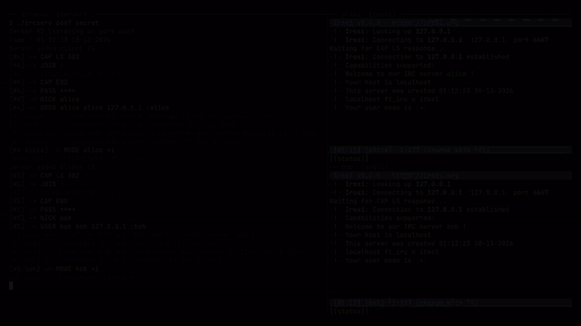

# ft_irc

An IRC server written in C++98, built as a team at 42 Lyon. A single process
handles every client with non-blocking sockets and one `poll()` loop, and
speaks enough of the IRC protocol (RFC 1459 / 2812) for real clients such as
irssi or HexChat to connect, chat in channels and manage them.

<p align="center"></p>

## Build and run

```sh
make
./ircserv <port> <password>     # e.g. ./ircserv 6667 secret
```

The port must be between 1025 and 65535. The server accepts up to 10 clients
and logs every IRC line it receives (`->`) and sends (`<-`):

```
[#4 alice] -> PRIVMSG #42 :hello bob
[#5 bob] <- :alice!alice@localhost PRIVMSG #42 :hello bob
```

## Connecting

With irssi:

```
/connect 127.0.0.1 6667 secret
```

With HexChat, add a network with server `127.0.0.1/6667` and the password
as *Server password*.

Or by hand with netcat:

```sh
nc -C 127.0.0.1 6667
PASS secret
NICK alice
USER alice 0 * :Alice
JOIN #42
PRIVMSG #42 :hello
```

## Supported commands

| Command   | Description                                               |
|-----------|-----------------------------------------------------------|
| `PASS`    | Server password, must come before `NICK`/`USER`           |
| `NICK`    | Set or change the nickname                                |
| `USER`    | Set the username and real name                            |
| `JOIN`    | Join (or create) channels, with an optional key           |
| `PART`    | Leave channels                                            |
| `PRIVMSG` | Message a channel or a user                               |
| `TOPIC`   | View or change a channel's topic                          |
| `INVITE`  | Invite a user to a channel                                |
| `KICK`    | Remove a user from a channel (operators only)             |
| `MODE`    | Change channel modes (see below)                          |
| `QUIT`    | Disconnect                                                |
| `CAP`     | Capability negotiation (no capabilities are offered)      |
| `PING`    | Keep-alive, answered with `PONG`                          |

The user who creates a channel becomes its operator. Channel modes:

| Mode | Effect                                                   |
|------|----------------------------------------------------------|
| `i`  | Invite-only channel                                      |
| `t`  | Only operators can change the topic                      |
| `k`  | Channel key (password) required to join                  |
| `o`  | Give / take channel operator privilege                   |
| `l`  | Limit the number of users in the channel                 |

## Authors

- [LezardSC](https://github.com/LezardSC)
- [MarcelCerdan](https://github.com/MarcelCerdan)